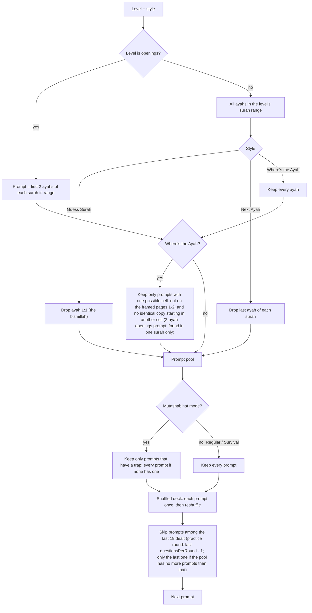
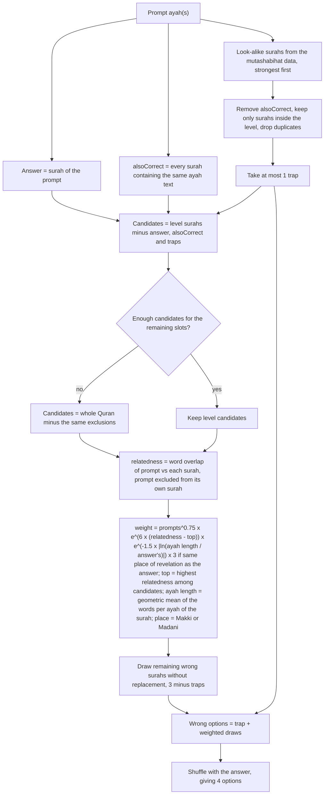
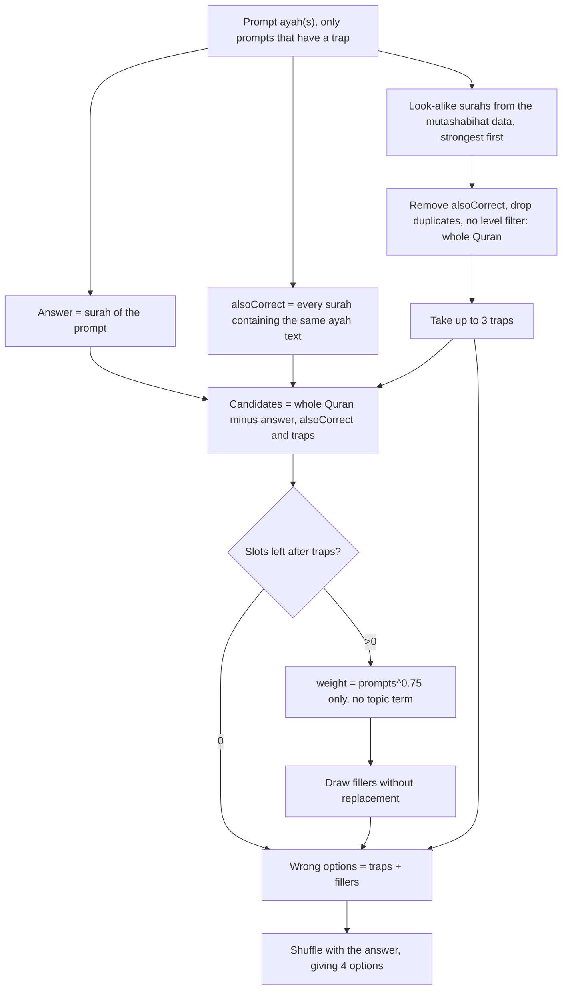
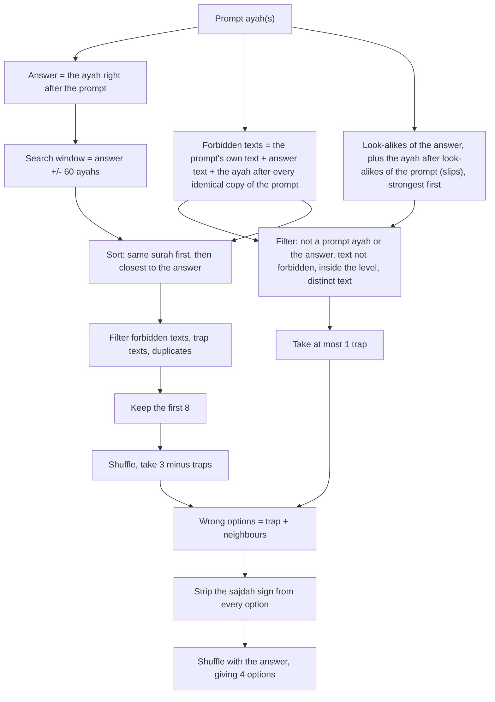
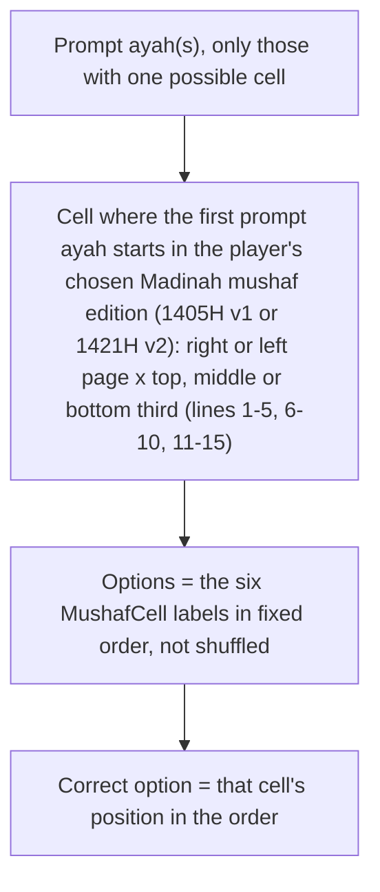

# Answer-option algorithms

How `QuestionGenerator` (`app/src/main/java/suft/android/hafiz/domain/QuestionGenerator.kt`) picks prompts and wrong options.
Regular and Survival build options the same way; they differ only in how the game ends (a fixed round versus the first
mistake), so they share each diagram below. Mutashabihat differs in the generator itself (`trapMode`), so it has its own.

Topic overlap comes from `domain/ThemeIndex.kt` (BM25 over the bundled Tanzil text). Words are folded (marks dropped,
alef/ya/ta marbuta/hamza-seat variants unified); a leading و or ف is dropped only when the rest is itself a word of the
Quran, then a leading ال/لل/بال/كال/فال/وال. Mutashabihat now always plays the whole Quran, so its "no level filter" step
excludes nothing.

Where's the Ayah (`GameStyle.AyahPosition`) has no wrong-option algorithm: its six options are fixed mushaf cells (section 6). Mutashabihat does not offer it (`GameStyle.hasLookAlikes = false`).

## 1. Shared: choosing the prompt

## 2. Guess Surah: Regular and Survival

## 3. Guess Surah: Mutashabihat

## 4. Next Ayah: Regular and Survival

## 5. Next Ayah: Mutashabihat

## 6. Where's the Ayah: Regular and Survival

The edition is a setting (`Progress.mushafEdition`, default v1) read when a round starts. Each edition has its own layout file, so the same ayah can start on a different page or line, and in a different cell, in the other print; the prompt pool is built from that edition's layout.

## Summary

| | Regular / Survival | Mutashabihat |
|---|---|---|
| Prompt pool | all prompts | only prompts with a trap (all if none has one) |
| Trap options | at most 1, from inside the level | up to 3, from the whole Quran |
| Guess Surah fillers | weighted by surah length, topic overlap, typical ayah length and Makki/Madani place | weighted by surah length only |
| Next Ayah fillers | nearby ayahs | nearby ayahs |
| Where's the Ayah options | six fixed mushaf cells | not offered |
