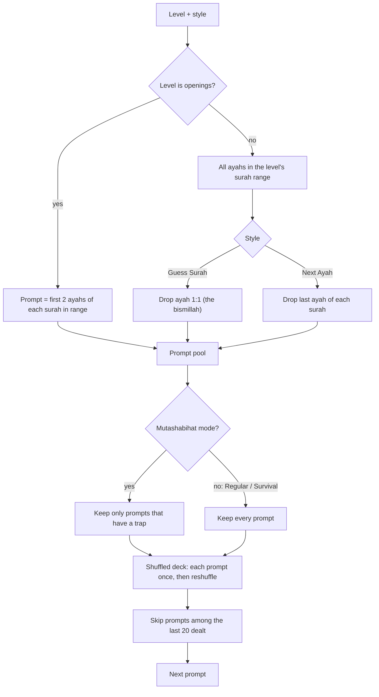
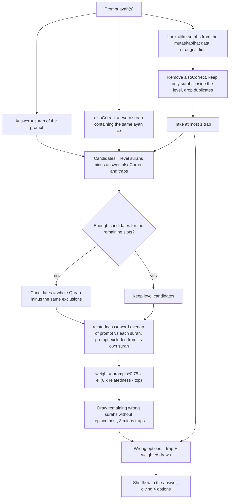
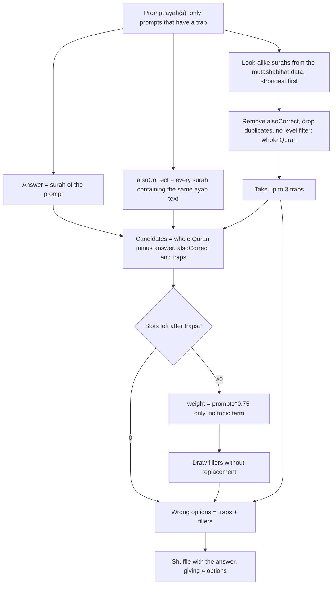
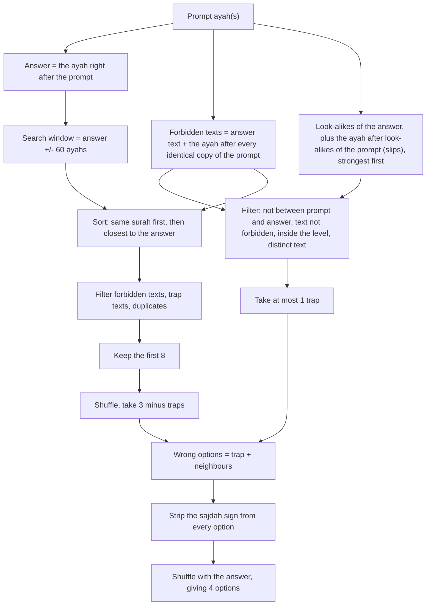
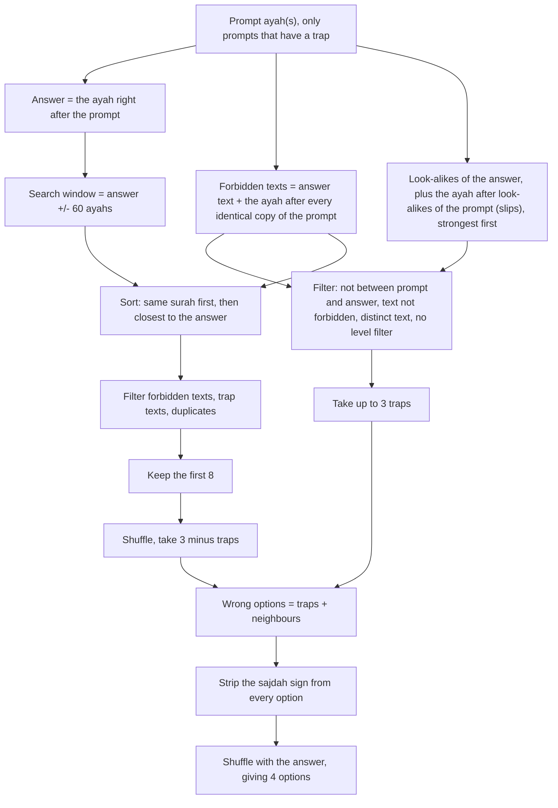

# Answer-option algorithms

How `QuestionGenerator` (`app/src/main/java/suft/android/hafiz/domain/QuestionGenerator.kt`) picks prompts and wrong options.
Regular and Survival build options the same way; they differ only in how the game ends (a fixed round versus the first
mistake), so they share each diagram below. Mutashabihat differs in the generator itself (`trapMode`), so it has its own.

Topic overlap comes from `domain/ThemeIndex.kt` (BM25 over the bundled Tanzil text). Mutashabihat now always plays the
whole Quran, so its "no level filter" step excludes nothing.

## 1. Shared: choosing the prompt

## 2. Guess Surah: Regular and Survival

## 3. Guess Surah: Mutashabihat

## 4. Next Ayah: Regular and Survival

## 5. Next Ayah: Mutashabihat

## Summary

| | Regular / Survival | Mutashabihat |
|---|---|---|
| Prompt pool | all prompts | only prompts with a trap |
| Trap options | at most 1, from inside the level | up to 3, from the whole Quran |
| Guess Surah fillers | weighted by length and topic overlap | weighted by length only |
| Next Ayah fillers | nearby ayahs | nearby ayahs |
