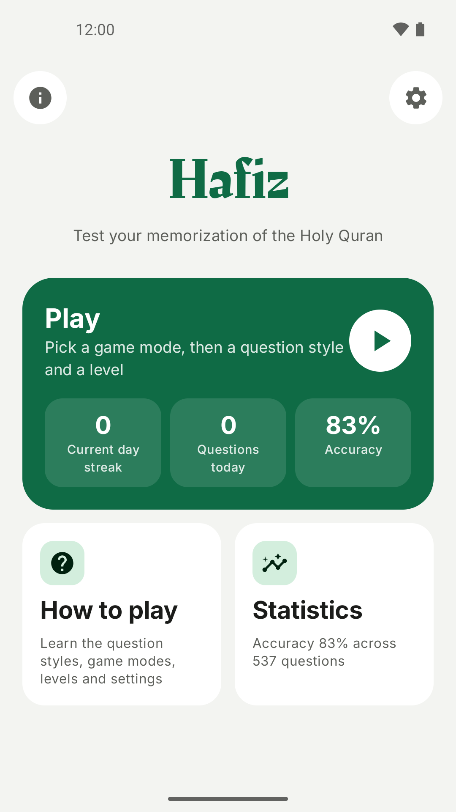
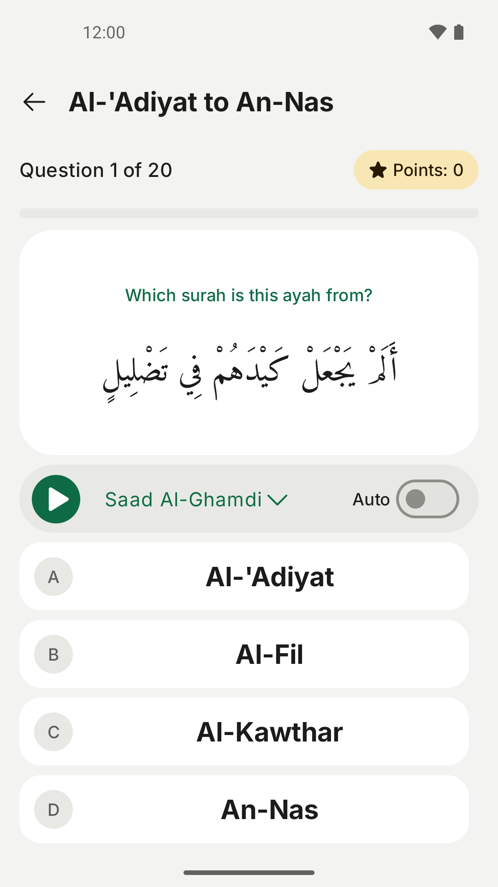
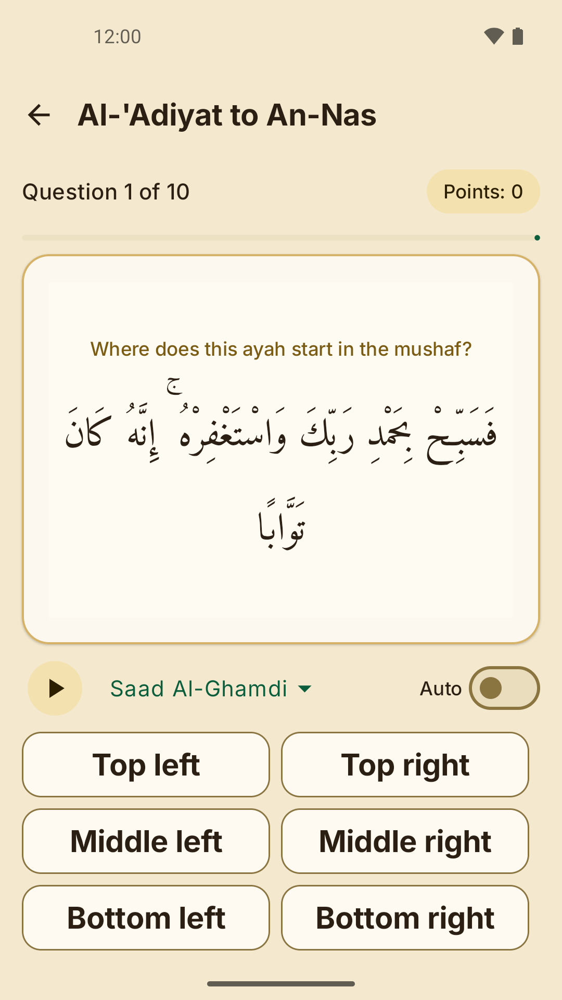
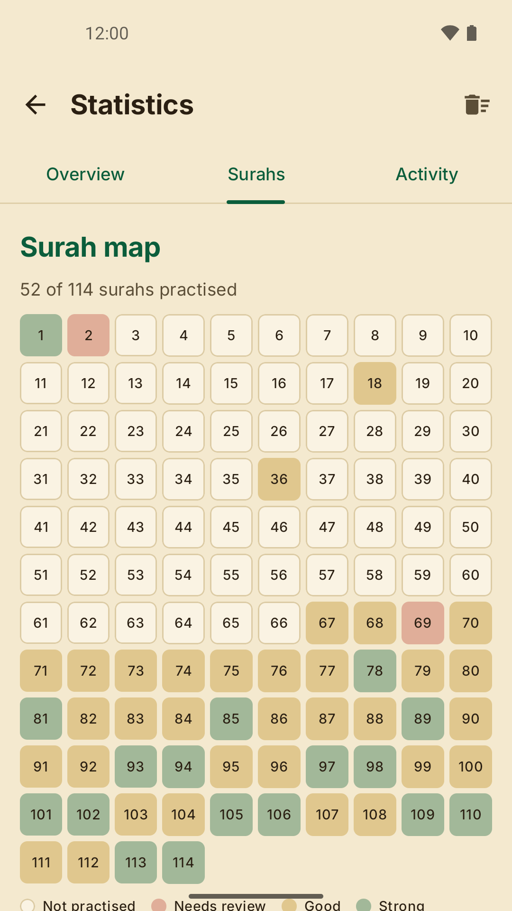
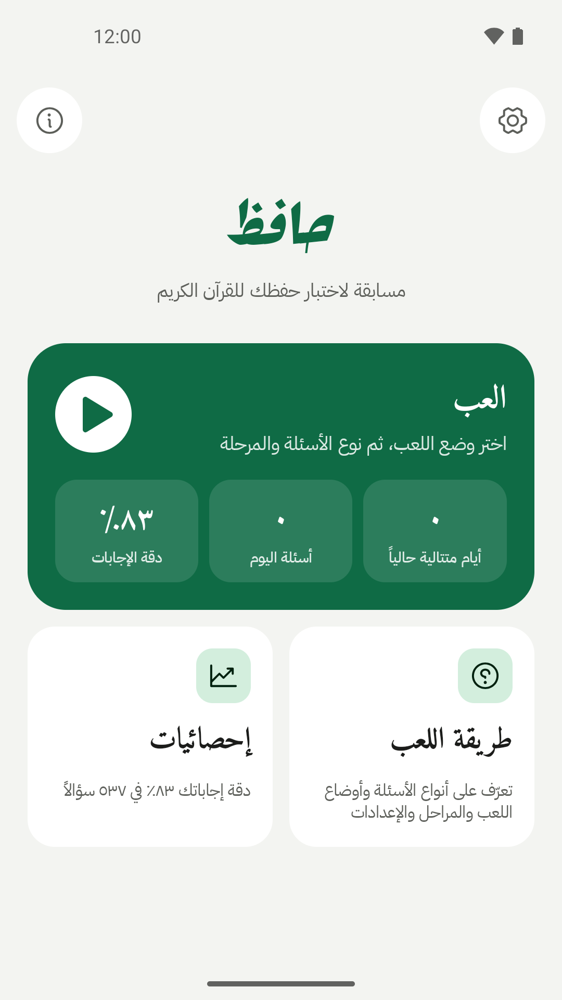
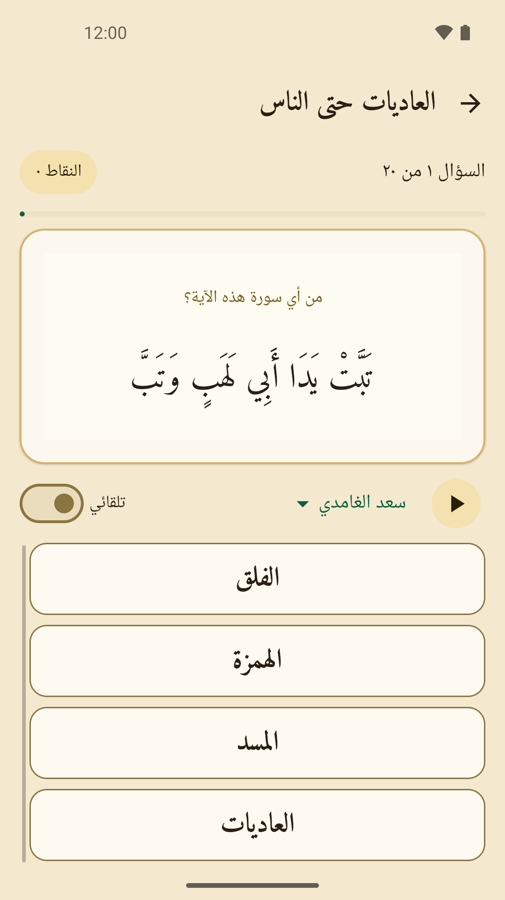
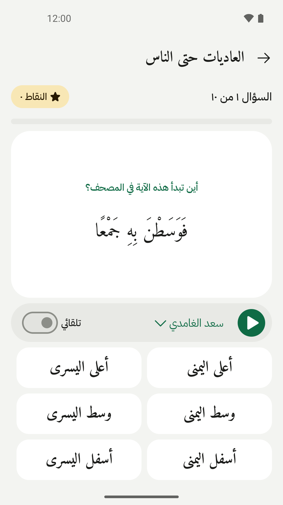
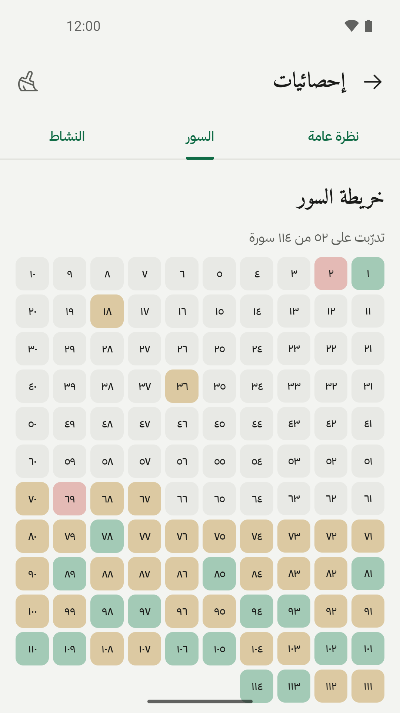

# Hafiz

<p align="center">
  
</p>

<p align="center">
  <a href="https://github.com/suft/hafiz/actions/workflows/build.yml"></a>
  <a href="LICENSE"></a>
  
  
  
</p>

A Quran memorisation quiz for Android, written in **Kotlin + Jetpack Compose** with a **mise** toolchain.

<p align="center">
  
  
  
  
</p>
<p align="center">
  
  
  
  
</p>

| Question style | What you do | Levels | Questions / round (Regular) |
|---|---|---|---|
| **آية وسورة** (guess the surah) | Read/hear an ayah and pick the surah it's from | 20 | 20 |
| **آيات** (next ayah) | Read/hear an ayah and pick the one that follows it | 25 | 10 |
| **أين الآية؟** (where's the ayah) | Read/hear an ayah and pick where it starts in the Madinah mushaf (1405H print) | 25 | 10 |

From the main menu, **Play** opens the **game modes**; pick a mode, then a question style and a level (Mutashabihat has no levels: it always plays the whole Quran). **How to play** explains the styles, modes and levels in the app.

| Game mode | How it ends | Score |
|---|---|---|
| **عادي** (Regular) | After a fixed-length round | Correct answers out of the round |
| **البقاء** (Survival) | First wrong answer | Correct answers in a row |
| **المتشابهات** (Mutashabihat) | Third wrong answer | Correct answers; the wrong options are *mutashabihat* traps: surahs and next ayahs that resemble the right answer |

In guess-the-surah, wrong surahs are drawn from the whole level, weighted by surah length and (Regular, Survival) by how many of the ayah's words they share, how close their typical ayah length (geometric mean of words per ayah) is to the answer's and whether they were revealed in the same place (Makkah or Madinah), so no option stands out by number, length, topic or style. The word overlap is computed on the device from the bundled Tanzil text (`domain/ThemeIndex.kt`); no topic data set is used. Regular and Survival also swap in one *mutashabihat* look-alike (a surah or next ayah from the same level that resembles the answer) when the prompt has one.

Survival keeps a best score per level; Mutashabihat keeps one best score per style. Their games show up in **إحصائيات** (stats: overall and per-style accuracy, the surahs to review, per-mode games played, best score, average and longest streak) and its activity history.

**مكية أم مدنية** (Makki or Madani) sits next to the modes on the Play screen. It has no styles or levels: five surahs, each answered Makki or Madani (equal chance of each; revelation places are quran.com's `revelation_place`, bundled in `domain/Revelation.kt`). The card shows the best score and every finished game appears in the activity history.

**أين الآية؟** (Where's the Ayah?) shows an ayah and asks where it starts in the open Madinah mushaf (1405H print): the right or left page × the top, middle or bottom third (lines 1–5, 6–10, 11–15), as a 3×2 grid with the right page on the right. It reuses the next-ayah levels and is not offered in Mutashabihat mode (its options are fixed, with no look-alikes). Ayahs on the framed pages 1–2, and ayahs whose identical copy starts in another part of the mushaf, are never asked.

Recitations stream from [everyayah.com](https://everyayah.com) (26 reciters). Quran text: [Tanzil](https://tanzil.net) (Simple, v1.0.2).

The interface language (Arabic or English) is chosen with the button on the main menu; on Android 13 and later it is also the app's language in the system settings (Apps → Hafiz → Language), and changing either one changes both. The Quran text is always Arabic.

---

## Build it

You only need [mise](https://mise.jdx.dev/getting-started.html) and `curl`/`unzip`. mise installs the JDK and the tasks download the Android SDK, so Android Studio isn't required.

```bash
cd hafiz
mise trust          # allow this project's mise.toml
mise install        # Temurin JDK 21
mise run setup      # Android cmdline-tools + platform 37 + build-tools (first run only)
mise run build      # -> dist/Hafiz-debug.apk
```

Install on a phone with USB debugging enabled: `mise run run` (installs and launches it), or copy `dist/Hafiz-debug.apk` to the phone.

### All tasks (`mise tasks`)

| Task | What it does |
|---|---|
| `setup` / `sdk` | Download the Android SDK into `.android-sdk/` (or use `$ANDROID_HOME` if it's already set) and write `local.properties` |
| `build` (`b`) | Debug APK → `dist/Hafiz-debug.apk` |
| `release` | Minified release APK → `dist/Hafiz-release.apk` |
| `bundle` | Release `.aab` for Google Play |
| `store-graphics` | Play Store icon and feature graphic → `fastlane/metadata/android/ar/images/` (ImageMagick 7) |
| `screenshots` | Play/README screenshots (4 Arabic, 4 English, 1080×1920) on a headless emulator → `fastlane/metadata/android/{ar,en-US}/images/phoneScreenshots/` (python3, KVM; first run downloads the emulator) |
| `keystore` | Create `release.jks` + `keystore.properties` for release signing |
| `mutashabihat` | Regenerate `assets/mutashabihat.txt` from Aswaatul Qurraa (python3) and merge the supplement |
| `mushaf-layout` | Regenerate `assets/mushaf_layout.txt` (the page and line of every ayah in the Madinah mushaf) from quran.com (python3) |
| `reciters` | Check that every reciter has all 6236 ayah files on everyayah.com (python3) |
| `test` (`t`) | JVM unit tests (quiz logic, progress, stats) and Robolectric UI tests |
| `lint` / `check` | Android lint / tests + lint |
| `install`, `run`, `logcat` | Install on a device via adb, launch it, follow its logs |
| `clean` | Delete build outputs |

**Release signing.** A release build needs a real key: run `mise run keystore` once (then back up `release.jks` and its password; both files are git-ignored), or set `HAFIZ_KEYSTORE_FILE`, `HAFIZ_KEYSTORE_PASSWORD`, `HAFIZ_KEY_ALIAS` and `HAFIZ_KEY_PASSWORD`. Without one, `assembleRelease` stops with an explanation instead of silently signing with the public debug key. For a local test build only, set `HAFIZ_ALLOW_DEBUG_SIGNING=1` (CI does); never distribute such an APK.

**Debug build.** It uses the package name `suft.android.hafiz.debug`, so it installs alongside the release build.

**Android Studio** works too: open the folder and it will use the Gradle wrapper. Run `mise run sdk` first, or let Studio create `local.properties` itself.

---

## Project layout

```
mise.toml                        tools (JDK), env (ANDROID_HOME), tasks
gradle/libs.versions.toml        all dependency versions
app/src/main/
  assets/quran_simple.xml        Tanzil Quran text (verbatim, keep the licence header)
  assets/mutashabihat.txt        similar-ayah pairs for Mutashabihat mode (generated: mise run mutashabihat)
  assets/mushaf_layout.txt       page and line where each ayah starts in the Madinah mushaf (generated: mise run mushaf-layout)
  java/suft/android/hafiz/
    domain/                      pure Kotlin: Quran index, XML parser, levels, question generator, stats
    data/ProgressRepository.kt   DataStore: best scores, per-surah stats, settings
    audio/                       reciters, ExoPlayer wrapper, disk cache
    ui/                          Compose: home, modes, guide, levels, quiz (+ViewModel), stats, theme
  res/font/                      Amiri, Rakkas, Inter (all OFL)
  res/drawable-nodpi/            Hafiz artwork, divider ornament, monochrome icon (own work)
tools/mutashabihat.py            regenerates assets/mutashabihat.txt from Aswaatul Qurraa (python3; --offline only merges the supplement)
tools/mutashabihat_supplement.txt  hand-curated pairs for the surahs the source does not cover
tools/check_reciters.py          checks every reciter's files on everyayah.com (also .github/workflows/reciters.yml)
tools/mushaf_layout.py           regenerates assets/mushaf_layout.txt from the quran.com API (python3)
tools/screenshots.py             captures the Play/README screenshots on an emulator (mise run screenshots)
docs/privacy-policy.md            privacy policy (GitHub Pages: https://suft.github.io/hafiz/privacy-policy.html)
fastlane/                        Play listing text and graphics (metadata/android/{ar,en-US}) and play-console.md (console answers)
app/src/test/                    JVM tests on the real Quran text (QuizLogicTest, QuestionCorrectnessTest, ProgressTest, ProgressStoreTest, StatsTest, ArabicTextTest, StringsTest)
                                 and Robolectric UI tests (quiz layout/lifecycle, navigation, stats); all run in `mise run test`
```

### Versions
AGP 9.4.1 · Gradle 9.8.2 · Kotlin 2.4.21 · Compose BOM 2026.09.00 · Media3 1.11.1 · compileSdk 37 · targetSdk 37 · minSdk 24.

All versions are in `gradle/libs.versions.toml`. Android Studio's *Upgrade Assistant* can bump them.

---

## Licences & credits
- **This project's code** is under the [MIT licence](LICENSE). It does not cover the third-party and bundled material below: the Quran text and fonts keep their own licences, the mutashabihat data (`assets/mutashabihat.txt`) is used with its owners' permission and is not licensed for reuse, and `assets/mushaf_layout.txt` is derived from quran.com data.
- **Quran text:** Tanzil Project, CC BY 3.0. The text must not be modified and the source must be credited with a link; the credits screen (the ⓘ button on the main menu) does this.
- **Recitations:** streamed from everyayah.com. One clip is truncated on the server and cannot be fixed here: `mahmoud_ali_al_banna_32kbps/012067.mp3` (surah 12, ayah 67). `mise run reciters` (also a weekly GitHub workflow) checks that every reciter has all 6236 files and lists known defects as warnings.
- **Mutashabihat mode:** ayah pairs derived from the data of [Aswaatul Qurraa](https://www.aswaatulqurraa.com/mutashabihat/), © Team Aswaatul Qurraa; only ayah references and a similarity score are bundled, and the credits screen credits the source. No licence is stated on the site; the developer has Team Aswaatul Qurraa's permission to use the data in Hafiz. The source covers 106 of the 114 surahs; `tools/mutashabihat_supplement.txt` adds hand-curated pairs for the other eight (99, 102, 106, 108, 109, 111, 113, 114) so Mutashabihat mode has traps for them too. Review those pairs before a release.
- **Where's the Ayah?:** the page and line where each ayah starts in the Madinah mushaf (1405H print, KFGQPC v1: 604 pages of 15 lines) come from the [quran.com API](https://api.quran.com/api/v4) (`v1_page` / `line_v1` of each ayah's first word); only those two numbers are bundled (`assets/mushaf_layout.txt`) and the credits screen credits the source.
- **Fonts:** Amiri / Amiri Quran, Rakkas and Inter are SIL Open Font License 1.1 (`assets/licenses/*-OFL.txt`).
- **Artwork:** `res/drawable-nodpi/hafiz.png` (launcher icon, loading screen and the Play icon and feature graphic), `divider_ornament.png` and the launcher icons are the developer's own work, all rights reserved; the MIT licence does not cover them.
